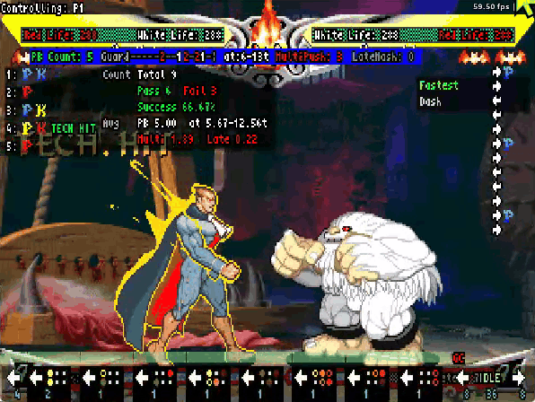
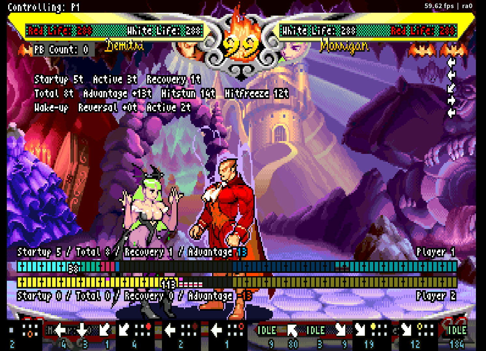
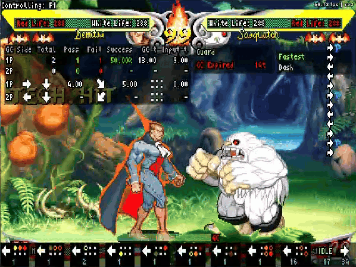
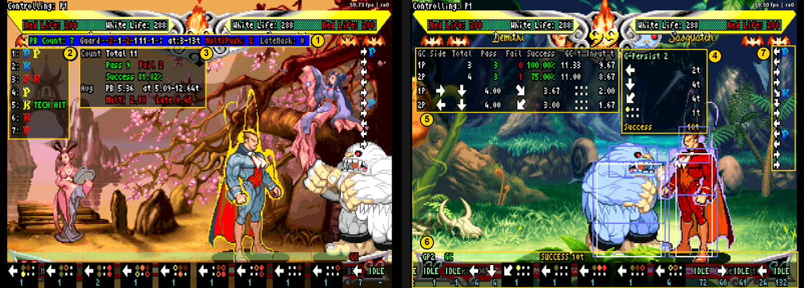

# VSAV_Training - The Warlord's Secret

**A Vampire Savior training mode for Fightcade 2.**

See what the Warlord sees, and practice what the Warlord practices.

[English](README.md) | 日本語

**達人の精密な動きを、練習相手に。** 『ヴァンパイア セイヴァー』のFightcade 2／FBNeo用トレーニングモードです。ダミーに相手の動きを正確に再現させ、自分の入力とタイミングを画面で振り返れます。

[VSAV_Trainingのfc2ブランチ](https://github.com/NBeing/VSAV_Training/tree/fc2)を基に拡張したフォークです。本書の対象は **v11.7.32.1** です。

**[ダウンロード（最新版）](https://github.com/vampiresavior001/VSAV_Training/releases/latest)** · [導入](#windowsでの導入) · [最初の練習](#first-ag-drill) · [日本語マニュアル](docs/PLAYER_MANUAL.ja.md) · [Discord](https://discord.gg/5fwSewN33p)

## このトレーニングモードでできること

- **ターボ3でも、最速の行動をダミーに再現させる。** ダミーの入力を内部フレーム（[Tick](#なぜtick単位なのか)）で制御します。起き上がり・ガード後・着地後のリバーサル、最速ダッシュからの攻撃、小技や投げの暴れを、狙ったタイミングで出させられます。
- **AGで、受付内に6回押せたかが分かる。** 14 Tickの受付のどこで何回押したか、同時押しや受付後の押し遅れがないかを表示し、成功率も集計します（[AG練習](docs/PLAYER_MANUAL.ja.md#08-pb)）。
- **GCで、どの入力がどこで切れたかが分かる。** ゲームが受け付けた方向・ボタンと入力間隔を追い、失敗した箇所を示します。左右それぞれの成功率も集計します（[GC練習](docs/PLAYER_MANUAL.ja.md#09-gc)）。

AGの成立やGCの入力受付には乱数が関わるため、一度成功しただけでは入力が安定しているとは限りません。成功した入力の改善点まで見えるのが、このツールの特長です。

サスカッチのショートダッシュ小Pに2回AG。2回目は受付内に6回押し切り、AGも成立しています。押した位置と回数、成功率がすぐ画面に出ます。

**同梱のサスカッチ用パターンで、動きを自分で作らずにAG・GCの練習を始められます。** [導入](#windowsでの導入)の後、[最初の練習](#first-ag-drill)へ進んでください。

## 練習相手の動きを作る

ダミーは、ガードした後・攻撃を受けた後・起き上がりなどのきっかけで、設定した動きを出します（[ダミーが動くしくみ](docs/PLAYER_MANUAL.ja.md#dummy-model)）。作り方は、必要に応じて次の順に広げるのがおすすめです。

1. **まずはCoinで記録する。** `P1 Coin`を押してダミーを操作し、もう一度押すと、その動きをダミーがすぐ再生します（[Quick Recording](docs/PLAYER_MANUAL.ja.md#quick-recording)）。
2. **正確さが必要になったらAction Steps。** 動作とタイミングをTick単位で指定し、最速ダッシュからの攻撃や中足払いキャンセル天雷破などを、毎回同じように再現します（[Action Steps](docs/PLAYER_MANUAL.ja.md#06-steps)）。記録・再生は表示フレーム単位なので、Tick単位の正確さが必要な動きはこちらで作ります。
3. **複数の攻めを混ぜるならAction Patterns。** 作った動きを名前を付けて保存し、使う候補からランダムに出させます（[Action Patterns](docs/PLAYER_MANUAL.ja.md#07-patterns)）。

技を1つ出させるだけなら、コマンドとボタンを指定する[Specified](docs/PLAYER_MANUAL.ja.md#dummy-guard-action)が手軽です。

## 攻めを調べる・技を測る

| 目的 | 使う機能 |
|---|---|
| **起き攻めの重なりを確かめる** | [Meaty Timing](docs/PLAYER_MANUAL.ja.md#meaty-timing)で、相手のリバーサルTickから何Tick後に、持続の何Tick目で当たったかを見る |
| **技の性能を数値と帯で見る** | [Tick Data](docs/PLAYER_MANUAL.ja.md#tick-data)で発生・持続・戻り・有利不利を内部フレーム単位で測り、[Frame Meter](docs/PLAYER_MANUAL.ja.md#frame-meter)で両プレイヤーの状態を1 Tickごとのマスで並べる |
| **チェーンや目押しの猶予を確かめる** | [Chain Trainer](docs/PLAYER_MANUAL.ja.md#chain-trainer)で、押したタイミングと受付・猶予を比べる |
| **同じ場面から繰り返す** | `Volume Up`（FBNeoの入力項目）かメニューで[状態を保存・復元](docs/PLAYER_MANUAL.ja.md#save-state)する。メニューを開くとゲームが止まるので、止めた場面も保存できる |

例：デミトリのジャンプ小Pをモリガンの起き上がりに重ね、リバーサル必殺技には着地してガードする詐欺飛び（[設定と確認手順](docs/PLAYER_MANUAL.ja.md#safe-jump-example)）。

ほかにも、[空中ガード後の割り込み](docs/PLAYER_MANUAL.ja.md#air-guard-gaps)、[順押しの超必殺技](docs/PLAYER_MANUAL.ja.md#command-trainer)、[レバガチャ](docs/PLAYER_MANUAL.ja.md#grab-mashing)、[めくりのオプションセレクト](docs/PLAYER_MANUAL.ja.md#side-switch-os)などの練習に使えます。目的からの探し方は、マニュアルの[練習の選び方](docs/PLAYER_MANUAL.ja.md#01-purpose)を参照してください。

## Windowsでの導入

対象ゲームは **Vampire Savior - the lord of vampire（970519 Japan／`vsavj`）** です。

**ROMは含まれません。各自で用意し、先にFBNeoでゲームが起動できる状態にしてください。**

**FBNeoの`Video > Runahead`は`Disabled`にしてください。** 有効なままでは、反撃などのタイミングが正しく再現されません。Fightcadeで対戦もする場合は、FBNeoフォルダーを丸ごと複製して練習専用にすると、設定を切り替えずに済みます。対戦は通常のFightcadeから、練習は複製先のバッチから起動します。

1. FightcadeとFBNeoを終了します。
2. Fightcadeの`emulator/fbneo`フォルダー全体を、別の場所へコピーします。例：`C:/VSAV_Training/fbneo`。
3. [最新版のzip](https://github.com/vampiresavior001/VSAV_Training/releases/latest)をダウンロードして展開し、`run_vsav_training.bat`と`scripts`フォルダー全体を、**複製先のfbneoフォルダー**へ配置します。バッチファイルは`fcadefbneo.exe`と同じ階層に置きます。
4. 複製先の`run_vsav_training.bat`を起動し、FBNeo本体の **`Video > Runahead > Disabled`** を選びます。元の設定もコピーされるため、複製するだけでは無効になりません。
5. FBNeoを完全終了して同じバッチから再起動します。`Video > Runahead`で`Disabled`が選ばれていることを確認します。試合中に`RUN-AHEAD DETECTED`の警告が出たら、設定と起動先を再確認してください。
6. `Input > Map Game Inputs`でゲーム操作とトレーニング用の機能を割り当てます。P2側のゲーム入力も設定してください。

**`Lua Hotkey 1`（メニューの開閉）と`P1 Coin`（記録の開始・終了）は、メニューで代用できないため必ず割り当ててください。** ほかのボタンと、メニューでの代用操作は[マニュアル1.2](docs/PLAYER_MANUAL.ja.md#02-install)の表にあります。

メニューは`Lua Hotkey 1`で開き、上端のタブ名で左右を押してタブを切り替え、上下で項目を選びます。LPは弱Pです。`>`は「タブ > 項目」の順を表します。

全画面で遊ぶときは、先に`Video > Blitter options > Windowed Fullscreen`にチェックを入れてください。古い形式の全画面では、パターンの名前入力やExport・Importのウィンドウを表示できません。

配置先は、日本語を含まない短いパスを使用してください（空白は含んでも構いません）。既存環境を更新する場合は、先に[バックアップ](#更新とバックアップ)を行います。

## 最初の練習：サスカッチを相手にAG・GCを練習する

サスカッチにショートダッシュ小Pをさせて、AG（アドバンシングガード）とGC（ガードキャンセル）を練習します。同梱パターンを使えば、動きを自分で作る前に練習を始められます。

最初はAGかGCのどちらかを試せれば十分です。連発や自分で動きを作る操作は、慣れてから進めてください。以下は流れです。実際の設定は[画像付きチュートリアル](docs/PLAYER_MANUAL.ja.md#sasquatch-ag-tutorial)に沿って進めてください。

1. **取り込む。** ダミーをサスカッチにし、`Dummy > Guard Action Type = Reversal - Action Patterns`にします。`Reversal Action Patterns`を開き、`Import from a File`で、配布物の`scripts/patterns/Sasquatch_Short_LP.json`を取り込みます。`Short LP`だけを使用する設定にします。
2. **AGする。** こちらの技をガードさせてショートダッシュ小Pを出させ、これにAGします。PB Counter／PB Stats（英語UIのPBはAGのこと）で、例えば遅らせAGで受付内に6回入力できたか確認します。
3. **GCも試す。** 同じ小Pに自キャラのGCを入力し、成功表示と、受け付けられた方向・ボタン・入力間隔を確認します。[GC Stats](docs/PLAYER_MANUAL.ja.md#gc-stats)で左右それぞれの成功率も確認できます。

   

   デミトリでGCが成立した例です。トレースには、ゲームが受け付けた方向とボタン、その間隔と `Success 11t` が出ます。

4. **連続で練習する。** `Loop Steps = yes`、`Loop Wait = Auto (Landing)`にして、着地からショートダッシュ小Pを繰り返させます。
5. **自分の練習へ広げる。** 取り込んだパターンは次回も使えます。慣れたらAction Stepsで別の攻めを作り、Action Patternsに保存して、複数候補のランダム練習へ発展させられます。

左：遅らせAGでも6回入力できたかを確認。右：GCの方向入力やボタンが、どこまで受け付けられたかを確認。各表示の読み方は[画面の見方](docs/PLAYER_MANUAL.ja.md#screen-map)へ。

入力表示の読み方と、結果に応じた調整方法は、[AG練習](docs/PLAYER_MANUAL.ja.md#08-pb)と[GC練習](docs/PLAYER_MANUAL.ja.md#09-gc)を参照してください。

## なぜTick単位なのか

Tickはゲームの内部フレームです。ターボ3では表示3フレームの間に4 Tick進むので、表示フレームで数えると、入力のタイミングも技の測定値もずれることがあります。本フォークは、この内部フレームに合わせてダミーの入力を制御します。

| ゲーム速度 | 表示フレームと内部フレームの関係 |
|---|---|
| ノーマル | 表示1フレーム＝1 Tick |
| ターボ3 | 表示3フレーム＝4 Tick |

Action StepsとTick Dataなどの測定はTick単位、記録・再生は表示フレーム単位です。ダッシュ系の既存トレーナーなど、表示フレームで数える表示も残っています。どの表示がどちらの単位かは[マニュアル11.1](docs/PLAYER_MANUAL.ja.md#ticks-and-frames)の一覧を確認してください。

## マニュアル

**[日本語プレイヤーマニュアル](docs/PLAYER_MANUAL.ja.md)** に、操作・設定・表示の読み方をまとめています。初めての方は、[3章のチュートリアル](docs/PLAYER_MANUAL.ja.md#sasquatch-ag-tutorial)から読み始めてください。

- **練習相手を設定する：** [ダミーのガード・受け身・反撃](docs/PLAYER_MANUAL.ja.md#04-dummy)、[記録とループ再生](docs/PLAYER_MANUAL.ja.md#05-recording)、[Action Steps](docs/PLAYER_MANUAL.ja.md#06-steps)、[Action Patterns](docs/PLAYER_MANUAL.ja.md#07-patterns)、[Auto Mash・Mash Meter](docs/PLAYER_MANUAL.ja.md#grab-mashing)
- **練習する：** [AG練習](docs/PLAYER_MANUAL.ja.md#08-pb)、[GC練習](docs/PLAYER_MANUAL.ja.md#09-gc)、[目的別の練習レシピ](docs/PLAYER_MANUAL.ja.md#11-drills)、[状態の保存・復元](docs/PLAYER_MANUAL.ja.md#save-state)
- **調べる：** [Tick Data](docs/PLAYER_MANUAL.ja.md#tick-data)、[Meaty Timing](docs/PLAYER_MANUAL.ja.md#meaty-timing)、[Frame Meter](docs/PLAYER_MANUAL.ja.md#frame-meter)、[空中ガードの分析](docs/PLAYER_MANUAL.ja.md#air-guard-gaps)、[Chain Trainer](docs/PLAYER_MANUAL.ja.md#chain-trainer)、[困ったとき](docs/PLAYER_MANUAL.ja.md#14-troubleshooting)

### 対応範囲

このREADMEの導入手順はWindows向けです。Linux用の起動スクリプトも同梱していますが、本フォークの全機能についてLinux／macOSで動作することは、このREADMEの作成時には確認していません。Action Patternsの名前入力・ファイル選択はWindows向けの実装です。

## 更新とバックアップ

FBNeoを終了する前に編集内容を保存し、次のファイルをバックアップしてください。

| 内容 | 保存先 |
|---|---|
| 設定・Action Steps・Action Patterns | `training_data/training_settings.json` |
| 記録 | `scripts/macro`フォルダー全体 |

設定ファイルは、`scripts`の外にある`training_data`フォルダーに置かれます。`training_data`を使う版を最初に起動すると、既存の`scripts/training_settings.json`が自動でそこへコピーされます。元のファイルは控えとしてその場に残りますが、以後は更新されません。記録は引き続き`scripts/macro`にあるため、両方をバックアップしてください。

更新はトレーニング専用の複製先へ行います。配布物に記録ファイルが含まれる場合があるため、自分の記録を不用意に上書きしないでください。更新後はFBNeoを完全に再起動し、`Video > Runahead`で`Disabled`が選ばれていることを確認します。

## 変更履歴・不具合報告

- [日本語リリースノート](docs/RELEASE_NOTES.ja.md)（冒頭に最近の主な追加機能のまとめがあります）
- [Release notes (English)](docs/RELEASE_NOTES.md)
- [このフォークのIssues](https://github.com/vampiresavior001/VSAV_Training/issues)
- [Discord](https://discord.gg/5fwSewN33p)：質問・不具合の報告・要望はこちらでも受け付けています

不具合を報告する際は、バージョン、P1／P2キャラクター、左右配置、設定画面、再現手順を添えてください。`Video > Runahead`で`Disabled`を確認し、赤いRunaheadの警告が出た場合はその旨も添えてください。

## フォーク元・クレジット

本プロジェクトは、[VSAV_Trainingのfc2ブランチ](https://github.com/NBeing/VSAV_Training/tree/fc2)を基にしています。フォーク元にも記録・反撃設定・AGカウンター・GC受付表示があります。本フォークはそれらを土台に、動作再現の精度と振り返りの詳しさを拡張しています。[機能比較](docs/PLAYER_MANUAL.ja.md#fork-comparison)も参照してください。基盤となるトレーニングモードと、各スクリプトを作成・改善してきた貢献者、VSAVコミュニティに感謝します。

Frame Meterは、tirsod氏の[VSAV_FrameMeter](https://github.com/tirsod/VSAV_FrameMeter)から取り込みました。

ゲーム内部の解析（ROMの逆アセンブル）は、VMP_MBD氏の[CPS2の解析資料](https://publish.obsidian.md/mbd/Projects/CPS2/CPS2+Projects)（ヴァンパイア セイヴァーの解析ノートを含む）を道しるべに進めました。最速リバーサルをはじめとする本フォークの改良は、この資料を手がかりにした解析から生まれました。深く感謝します。Tick Dataの数え方は、[Darkstalkers Frame Data（ヴァンパイアセイヴァー データ）](http://darkstalkers.web.fc2.com/savior/savior.html)の技表に合わせています。

フォーク元READMEのクレジット

Shoutouts to: Dammit and Jed for their wizardry, Grouflon (Stole their 3s training mode menu, and settings workflow!) and the VSAV Community.

BIGGEST SHOUTOUT to KyleW! This definitely would not have happened or continued without you.

`N-Bee`

